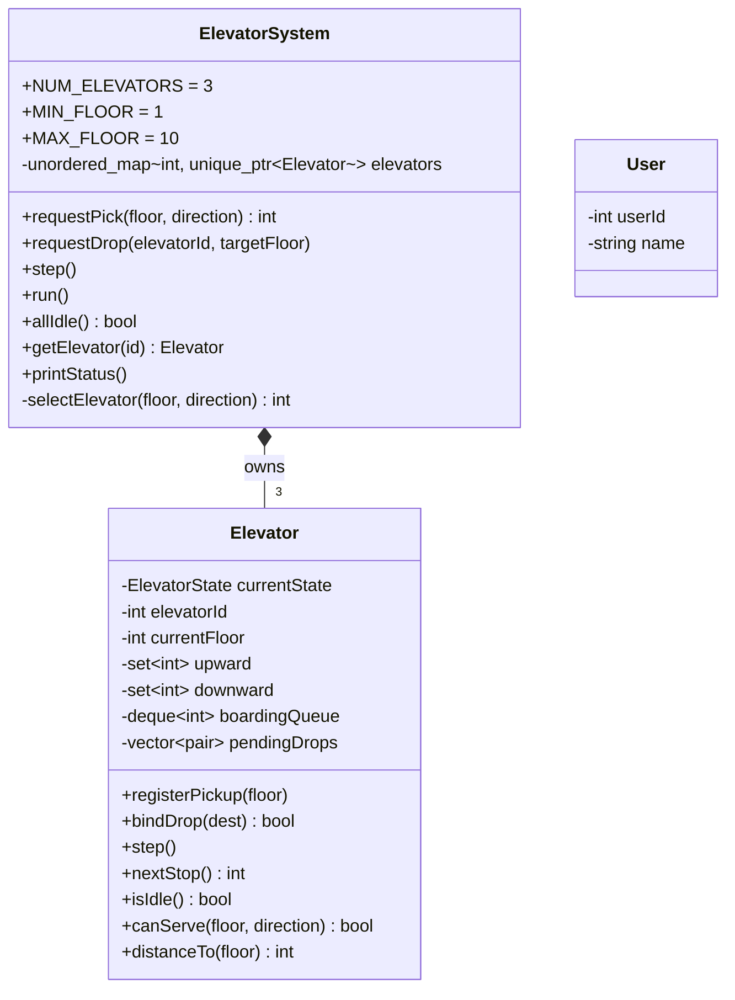
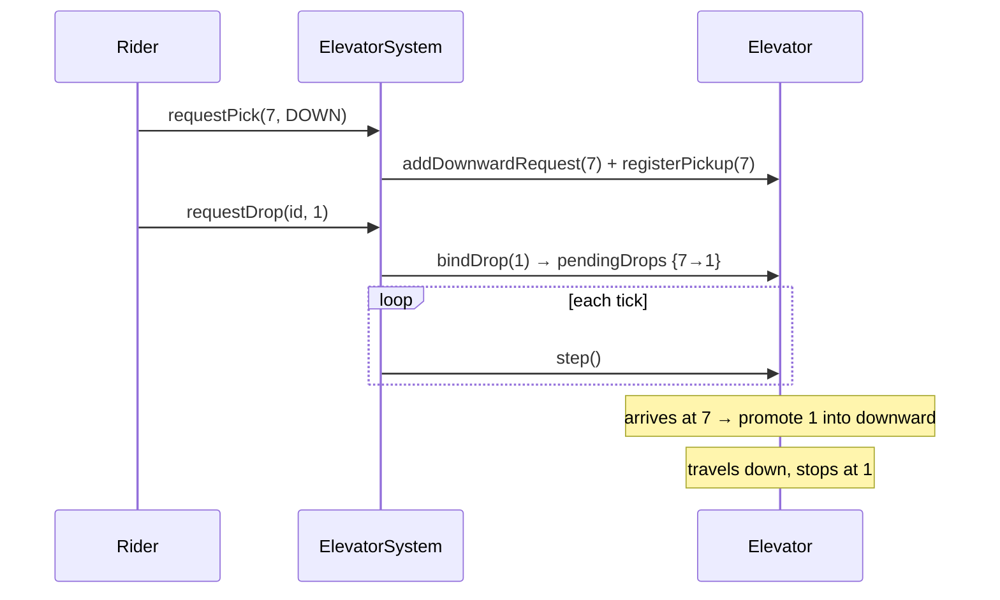

# Elevator System

A low-level-design exercise in C++17: a bank of three elevator cars in a
10-floor building, driven by the **SCAN** algorithm, with a facade that assigns
hall calls to the best car.

> **Authorship note:** The system design and architecture — the class
> structure, the SCAN-based scheduling approach, the deferred-drop model, and
> the elevator-assignment strategy — are entirely my own work. Only the code
> implementing that design was written with the help of
> [Claude](https://claude.com/claude-code).

---

## Building and running

Requires a C++17 compiler (`g++`/`clang++`) and `make`.

| Command | Purpose |
|---|---|
| `make` / `make all` | Build the `elevator` driver binary |
| `make run` | Build and run the driver (`main.cpp`) |
| `make test` | Build and run the unit tests (`tests.cpp`) |
| `make check` | Syntax-only (`-fsyntax-only`) pass over every source file |
| `make clean` | Remove objects and both binaries |

The build uses `-std=c++17 -Wall -Wextra -Wpedantic -g` and is kept
warning-clean.

`main.cpp` and `tests.cpp` each define their own `main()`. The Makefile compiles
the class implementations once and links them against either `main.o`
(→ `elevator`) or `tests.o` (→ `run_tests`).

### Tests

`tests.cpp` uses a small hand-rolled harness. `make test` runs every entry in the
`kTests[]` array, prints `PASS`/`FAIL` per test plus a tally, and exits non-zero
on any failure. To run a subset, comment out entries in `kTests[]`.

---

## Project layout

| File | Contents |
|---|---|
| `ElevatorState.h` | `enum class ElevatorState { REST, UP, DOWN }` |
| `Direction.h` | `enum class Direction { UP, DOWN }` — hall-call direction |
| `User.h/.cpp` | Inert `{userId, name}` record, used by the driver for log lines |
| `Elevator.h/.cpp` | One car: SCAN state, movement, pending stops |
| `ElevatorSystem.h/.cpp` | Facade: owns the cars, validates and assigns requests, steps time |
| `main.cpp` | Driver that feeds hall calls over simulated time and logs decisions |
| `tests.cpp` | Unit tests |

---

## Architecture

### `ElevatorSystem` — the facade

Owns exactly three cars (ids `1..3`) through `unique_ptr`, stored in an
`unordered_map` keyed by id. Floors range `MIN_FLOOR..MAX_FLOOR` (1..10).

- `requestPick(floor, direction)` — a hall button press. Validates the request,
  chooses a car, registers the boarding stop, and returns the car's id.
- `requestDrop(elevatorId, targetFloor)` — a rider inside the car picks a floor.
- `step()` — advance every car by one tick.
- `run()` — step until `allIdle()` (bounded at 1000 ticks).
- `getElevator(id)` / `printStatus()` — read-only inspection.

Validation: `requestPick` rejects out-of-range floors, `UP` from the top floor
and `DOWN` from the bottom floor; `requestDrop` rejects out-of-range floors and
unknown elevator ids. Both throw `std::invalid_argument`.

### `Elevator` — one car

Each car holds its state (`REST`/`UP`/`DOWN`), current floor, and its pending
stops split into **two ordered sets**:

- `upward` — floors to visit while travelling up, served in ascending order
- `downward` — floors to visit while travelling down, served in descending order

### Simulation model

Time is discrete. One `step()` moves each car at most one floor. Cars are
independent, so the order in which they are stepped does not matter. There is no
threading, no real clock and no passenger objects.

---

## Scheduling: SCAN

`Elevator::nextStop()` decides where the car goes next:

1. **Moving** — keep going in the current direction while the matching set has
   work beyond the current floor.
2. Otherwise **turn around** and head for the far end of the other set.
3. From **REST** — head to the nearest pending floor in either set.

`Elevator::step()` moves one floor toward `nextStop()` and clears the floor it
arrives at.

**Turnaround rule.** On arrival a moving car always clears the floor from the
set for its current direction, but clears it from the *opposite* set only when
nothing remains further along the current sweep — i.e. only at the point where
the car actually reverses. This stops an up-moving car from "serving" a down
hall call it merely passes on the way up.

---

## Deferred drops

`requestDrop` carries only a destination, not a boarding floor, and is normally
called *before* the car has reached the rider. Routing the destination by
comparing it with the car's current floor would therefore be wrong (the car may
still be deadheading to the rider). Instead destinations are deferred:

1. **`requestPick`** adds the boarding floor to `upward`/`downward` and calls
   `registerPickup(floor)`, pushing it onto a FIFO `boardingQueue`.
2. **`requestDrop`** calls `bindDrop(dest)`, which pops the oldest boarding floor
   and parks `{boardingFloor, dest}` in `pendingDrops`. The destination is *not*
   yet an active stop. If `boardingQueue` is empty (rider already aboard),
   `bindDrop` returns `false` and the system routes `dest` directly by the car's
   current floor.
3. **On arrival**, `step()` promotes every parked entry whose boarding floor
   matches the current floor into `upward`/`downward` — the rider is now aboard.

FIFO binding assumes each rider calls `requestDrop` before the next rider calls
`requestPick` on the same car.

---

## Assignment strategy

`ElevatorSystem::selectElevator(floor, direction)` makes one pass over the cars
and tracks two candidates:

- **Preferred** — the nearest car for which `canServe(floor, direction)` is
  true: it is at `REST`, or already moving toward `floor` in the same direction.
- **Fallback** — the globally nearest car, which will pick the call up on a later
  sweep.

The preferred candidate wins if one exists, otherwise the fallback. Ties break to
the lowest id, since `unordered_map` iteration order is unspecified.

---

## Invariants

- Every `pendingDrops` entry's boarding floor stays in `upward`/`downward` until
  the car reaches it, so `isIdle()` (both sets empty) is a correct "no work"
  signal without consulting `pendingDrops`.
- Output (`printStatus`, the driver) iterates ids `1..NUM_ELEVATORS` explicitly
  so it is deterministic despite hash-map storage.
